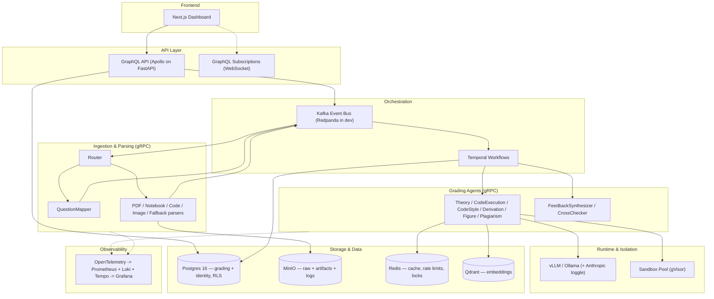
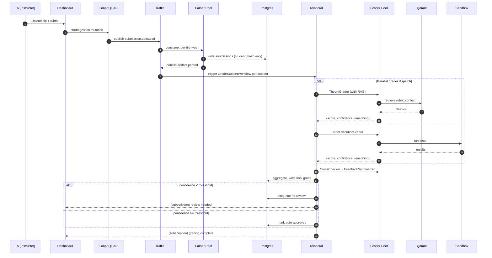
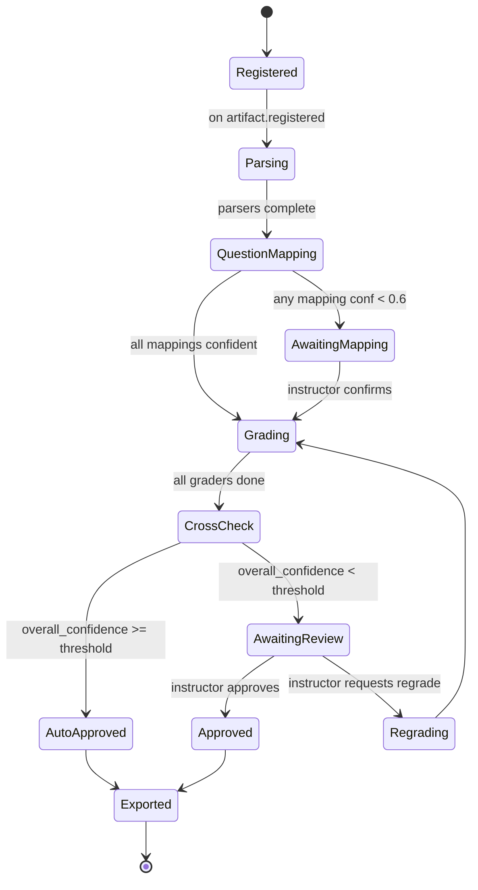

# Autograde AI — Architecture

This is a condensed architecture reference. The authoritative and complete
design lives in [`../PROJECT_PLAN.md`](../PROJECT_PLAN.md); this document exists
so the diagrams are one click away during development.

## Component view

## Sequence: submission through grade

## Per-student workflow states

## Local port map (dev)

| Service | Port(s) | Purpose |
|---|---|---|
| Postgres | 5432 | Primary DB |
| Redis | 6379 | Cache / locks / rate limits |
| Redpanda (Kafka API) | 9092 | Event bus |
| Redpanda Console | 8080 | Kafka topic UI |
| MinIO API / Console | 9000 / 9001 | Object store |
| Qdrant HTTP / gRPC | 6333 / 6334 | Vector store |
| Temporal | 7233 | Workflow engine |
| Temporal UI | 8233 | Workflow UI |
| OTel Collector | 4317 / 4318 | OTLP gRPC / HTTP ingest |
| Prometheus | 9090 | Metrics |
| Grafana | 3001 | Dashboards |
| Loki | 3100 | Logs |
| Tempo | 3200 | Traces |
| API (FastAPI + GraphQL) | 8000 | Gateway |
| Next.js dashboard | 3000 | Frontend |

Application service `/healthz` ports are enumerated in
[`phases/phase-0-foundation.md`](phases/phase-0-foundation.md).
