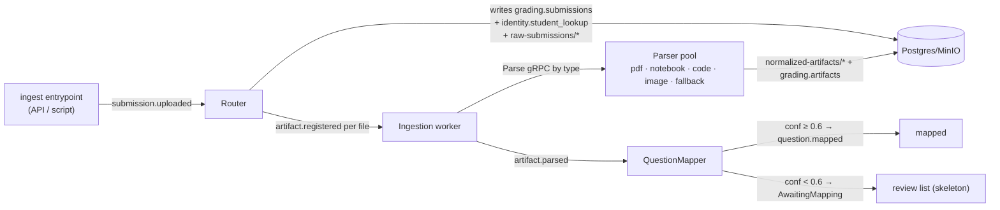

# Phase 1 — Ingestion & Parsing

**Status:** plan for review (no code yet).
**Branch:** `phase-1-ingestion`.
**Prerequisite:** Phase 0 complete and verified.
**Depends on decisions:** see [Open decisions for this phase](#open-decisions-for-this-phase)
— a few materially shape the build; please resolve them on review before I start.

---

## Why this phase exists

Real submissions are structurally disordered: nested folders, inconsistent
filenames, and mixed formats. Without a clean normalization step every grader
downstream has to reinvent parsing. And mapping the right answer to the right
question is the single highest-impact correctness lever in the pipeline — a
mislabeled answer is graded against the wrong rubric no matter how good the
grader is. Phase 1 turns a messy zip into a **canonical artifact stream** with a
best-guess question mapping and a confidence gate on the uncertain ones.

## What "done" looks like (Definition of Done)

1. A real-shaped test zip of **25 synthetic submissions** ingests fully, end to
   end, driven by Kafka.
2. **≥95%** of files land in the correct `artifact_type`; parse-failure (fallback
   bucket) rate **<3%**.
3. Every artifact is persisted to Postgres (`grading.artifacts`) with its
   normalized content in MinIO (`normalized-artifacts/`).
4. QuestionMapper produces a mapping + confidence for each artifact; the
   **confidence distribution is reported**, and mappings **<0.6** are withheld
   into an `AwaitingMapping` review list instead of proceeding.
5. The identity ↔ hash boundary holds: `grading.*` rows carry only
   `student_hash`; real names live only in `identity.student_lookup`.
6. Unit tests for each parser + an end-to-end ingestion test are green; the
   artifact-type accuracy and confidence distribution are emitted as a report.

## Scope

**In:** Router, the five parsers (PDF, Notebook, Code, Image, Fallback),
QuestionMapper (heuristic — see decisions), the canonical artifact schema, the
`submissions`/`artifacts` DB writes, the identity registration step, the
Kafka-driven ingestion flow, the synthetic data generator, and a **skeleton**
review list for low-confidence mappings.

**Out (later phases):** grading of any kind (Phase 3+), RAG grounding (Phase 2),
Temporal orchestration (Phase 3 — Phase 1 uses a plain Kafka worker), the full
review/approve/edit UI (Phase 5), and LLM/vision-model calls (Phase 3).

## Architecture & flow

Phase 1 is pre-Temporal, so a lightweight **ingestion worker** drives the flow
off Kafka. Each parser is a real gRPC server (the contract Temporal will call in
Phase 3); the worker invokes them. When Temporal lands, the worker's logic
becomes activities with no interface churn.



State per submission advances `Registered → Parsing → QuestionMapping →
{AwaitingMapping | Mapped}`, matching PROJECT_PLAN §4.3 (grading states are
Phase 3).

**Idempotency:** every file carries a stable `sha256`; re-running ingestion or
replaying Kafka re-derives the same `artifact_id` (a deterministic hash of
`submission_id + source_file + sha256`) and upserts, so no duplicate artifacts.

## Canonical artifact schema (locked this phase)

Pydantic models in `autograde_core.models`; the JSON body is stored at
`normalized-artifacts/<assignment_id>/<student_hash>/<artifact_id>.json` and
referenced by `grading.artifacts.content_ref`.

```
Artifact
  artifact_id: UUID            # deterministic; see idempotency
  submission_id: UUID
  source_file: str             # raw-submissions/ key
  artifact_type: "theory" | "code" | "figure" | "derivation" | "unknown"
  question_id: str | None      # filled by QuestionMapper
  question_mapping_confidence: float | None
  content_ref: str             # normalized-artifacts/ key
  content: TheoryContent | CodeContent | FigureContent | DerivationContent
  metadata: dict               # parser-specific (page count, cell types, ...)

TheoryContent      { text }
CodeContent        { language, source, imports[], functions[], entry_points[] }
FigureContent      { image_ref, ocr_text?, caption? }
DerivationContent  { raw_text, steps[] }
```

`unknown` is the fallback-bucket type; it is surfaced for manual triage and
counts against the <3% parse-failure target.

## Components

| Component | Kind | Phase 1 responsibility |
|---|---|---|
| **Router** | gRPC + Kafka consumer (`submission.uploaded`) | Unzip from `raw-uploads/`, group files per student (deterministic), compute `student_hash = HMAC(assignment_id, canvas_id, secret)`, write `grading.submissions` + `identity.student_lookup`, copy files to `raw-submissions/`, emit `artifact.registered` per file with a type hint. |
| **PDFParser** | gRPC | PyMuPDF text extraction → `theory`/`derivation`; pages that are image-only are emitted as `figure` with the image ref. |
| **NotebookParser** | gRPC | `nbformat` splits cells: markdown → `theory`, code → `code`, image outputs → `figure`. |
| **CodeParser** | gRPC | Tree-sitter parse (Python first); extract `imports`, `functions`, `entry_points` into `CodeContent`. |
| **ImageParser** | gRPC | Store the image ref; lightweight OCR for text-in-image (see Tesseract decision). Diagram/plot understanding via vision model is deferred to Phase 3. |
| **FallbackParser** | gRPC | `.txt`, `.md`, `.docx` (python-docx) → `theory`; anything unrecognized → `unknown`. |
| **QuestionMapper** | gRPC + Kafka consumer (`artifact.parsed`) | Best-guess `question_id` + confidence per artifact; gate at 0.6. **Heuristic in Phase 1** (filename cues + keyword/overlap against rubric question prompts); LLM/RAG-assisted upgrade in Phase 2–3. |
| **Ingestion worker** | Kafka consumer | Consumes `artifact.registered`, dispatches to the right parser gRPC by type, persists results, emits `artifact.parsed`. Becomes Temporal activities in Phase 3. |

## Data & storage touched

- **Postgres:** `grading.submissions`, `grading.artifacts` (writes);
  `identity.student_lookup` (privileged write at registration only).
- **MinIO buckets:** `raw-uploads/` (in), `raw-submissions/` (Router output),
  `normalized-artifacts/` (parser output). Created idempotently on startup.
- **Kafka topics (already exist):** `submission.uploaded`, `artifact.registered`,
  `artifact.parsed`, `question.mapped`.
- **DB access layer:** SQLAlchemy models in `autograde_db` mirroring
  `infra/postgres/init.sql`, plus an Alembic baseline (see decisions).

## New dependencies (for approval)

| Package | For | Notes |
|---|---|---|
| `grpcio` (runtime), `grpcio-tools` (dev, already present) | gRPC servers + codegen | Stubs generated into a gitignored `autograde_core.pb`; `scripts/gen_proto.py` added |
| `pymupdf` | PDFParser | Pure-wheel on Windows |
| `nbformat` | NotebookParser | — |
| `tree-sitter`, `tree-sitter-python` | CodeParser | Python grammar only in Phase 1 |
| `pytesseract`, `Pillow` | ImageParser OCR | **Requires the Tesseract system binary** — see decisions |
| `python-docx` | FallbackParser | `.docx` |
| `minio` | object storage client | S3 API |
| `matplotlib`, `reportlab` | synthetic data generator only | Produce plots + PDFs for the test zip |

All are named in or implied by PROJECT_PLAN §8; listing them here for the
"new dependency" sign-off rule.

## Synthetic test data (`scripts/seed_synthetic_data.py`)

Deterministic (seeded) generator producing a `raw-uploads/` zip of **25
submissions** that reproduces the messy-zip problem: nested and flat folders,
inconsistent filenames (`q1.pdf`, `Question_2.ipynb`, `hw3_final.py`,
`scan.png`), and mixed formats (PDF, `.ipynb`, `.py`, `.png` plot, `.txt`,
`.docx`). Answers span correct / partial / wrong so later phases have signal.
Real names live only in a side manifest the Router consumes to build
`identity.student_lookup`; the zip itself uses Canvas-style `name_canvasid_*`
naming so Router grouping is exercised realistically.

## Checkpoint commits

| # | Commit | Contents |
|---|---|---|
| P1.1 | `chore: add grpc runtime + protobuf codegen` | `grpcio`, `scripts/gen_proto.py`, gitignored stubs, gen wired into dev flow |
| P1.2 | `feat: canonical artifact schema and storage/event helpers` | `autograde_core.models`, MinIO wrapper, Kafka producer/consumer helpers, bucket bootstrap |
| P1.3 | `feat: db models and alembic baseline` | `autograde_db` ORM for submissions/artifacts + identity; Alembic baseline |
| P1.4 | `feat: router service` | grouping, HMAC hashing, identity + submissions writes, `artifact.registered` |
| P1.5 | `feat: pdf, notebook, and code parsers` | three gRPC parsers + unit tests |
| P1.6 | `feat: image and fallback parsers` | two gRPC parsers + unit tests |
| P1.7 | `feat: question mapper with confidence gate` | heuristic mapper, 0.6 gate, `question.mapped` / AwaitingMapping |
| P1.8 | `feat: ingestion worker wiring end to end` | Kafka-driven dispatch across the parser pool |
| P1.9 | `feat: synthetic submissions generator` | real `seed_synthetic_data.py` (25 submissions) |
| P1.10 | `feat: low-confidence mapping review skeleton` | dashboard list + confirm stub |
| P1.11 | `test: end-to-end ingestion + artifact-type and confidence report` | e2e test on 25 submissions; metrics emitted |

## Open decisions for this phase

Please resolve on review — each changes what I build:

1. **QuestionMapper = heuristic in Phase 1?** PROJECT_PLAN §8 calls it
   "LLM-assisted," but the LLM client doesn't exist until Phase 3 and RAG until
   Phase 2. I propose a deterministic heuristic (filename cues + keyword overlap
   with rubric prompts) that establishes the interface + 0.6 gate now, with the
   LLM/RAG upgrade layered in Phase 2–3. **Recommended.** Alternative: pull a
   minimal Ollama call forward (blocks on model/hardware, an unresolved global
   open-decision).
2. **ImageParser OCR — install Tesseract now, or defer?** Full OCR needs the
   Tesseract system binary (separate Windows install), and diagram/plot
   understanding needs the vision model (Phase 3). I propose Phase 1 stores the
   image + any trivially embedded text and marks richer extraction as deferred,
   so ingestion stays local-model-free. Alternative: install Tesseract and do
   real OCR now.
3. **Schema ownership: `init.sql` vs Alembic.** `init.sql` seeds the container
   on first boot. I propose it stays the Phase 0 baseline and Alembic takes over
   forward evolution from Phase 1 (initial migration = stamp of baseline).
4. **Dependency list above** — approve as a set, or trim any.

## How to verify (once built)

```bash
docker compose up -d
uv run python scripts/gen_proto.py
uv run python scripts/seed_synthetic_data.py --students 25 --out data/uploads
# start parser gRPC servers + ingestion worker (dev runner), then:
uv run python scripts/ingest.py data/uploads/<zip>          # publishes submission.uploaded
uv run pytest tests/integration/test_ingestion_e2e.py -q    # asserts ≥95% type accuracy, <3% fallback
uv run python scripts/report_ingestion.py                   # prints confidence distribution
```
