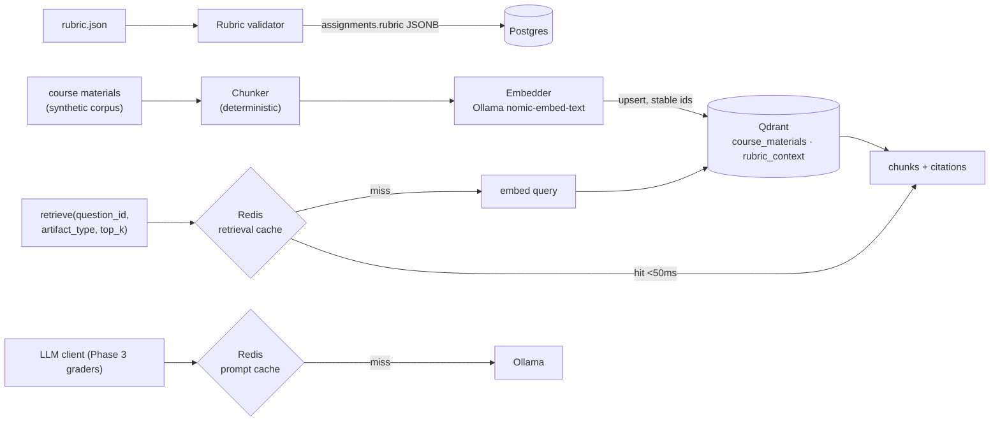

# Phase 2 — Rubric & RAG Layer

**Status:** plan for review (no code yet).
**Branch:** `phase-2-rubric-rag`.
**Prerequisite:** Phase 1 complete (`phase-1-complete` tag); Docker stack
running (Ollama not needed for retrieval — embeddings are in-process).
**Decisions:** resolved on review — embeddings via **sentence-transformers
`all-MiniLM-L6-v2` (384-dim, in-process)**; reference answers **indexed
flagged and excluded from grader-facing retrieval by default**. See
[Decisions for this phase](#decisions-for-this-phase).

---

## Why this phase exists

LLM grading without grounding hallucinates plausible-sounding wrong feedback.
Retrieval anchors the model to the actual course material: when TheoryGrader
scores q1, its prompt carries the exact lecture passages that define
call-by-name, not the model's memory of them. Phase 2 builds that grounding
layer — rubric validation, a chunk→embed→index pipeline into Qdrant, a
retrieval service with Redis caching, and the rubric-prefix prompt cache that
Phase 3's graders will hit on every call. This is also where the audit trail
gets its `retrieval_citations`: every grade in Phase 3+ can point at exactly
which chunks grounded it.

## What "done" looks like (Definition of Done)

1. **Rubric validator** rejects malformed rubrics with actionable, per-field
   errors; every valid rubric round-trips loader → model → JSONB.
2. **Course materials indexed:** synthetic corpus chunked, embedded, and
   upserted into Qdrant `course_materials` + `rubric_context`; re-indexing is
   idempotent (stable chunk ids, no duplicates).
3. **Retrieval is correct:** for every rubric question, `retrieve(question_id,
   artifact_type, top_k)` returns chunks whose source document matches the
   question's topic — hit-rate reported, target **≥90% top-3**.
4. **Retrieval is fast:** measured over repeated calls — **<50ms cached,
   <200ms cold** (per PROJECT_PLAN §9 Phase 2 DoD).
5. **Reference answers never leak:** chunks flagged `reference_answer: true`
   are excluded from grader-facing retrieval by default (the "how does RAG
   avoid retrieving the reference answer verbatim" interview answer, built in).
6. **Prompt cache works:** identical rubric-prefix completions hit Redis
   (`prompt:<sha256(model,system,rubric_prefix,q_id)>`, TTL 24h) — proven by a
   live two-call test where the second call is a cache hit with ~0 latency.
7. Unit tests for validator, chunker, cache keying; opt-in integration tests
   for indexing, retrieval correctness, and the latency benchmark.

## Scope

**In:** rubric parser/validator, chunking + embedding pipeline, Qdrant
collections + indexer, retrieval service (gRPC + in-process library),
Redis retrieval cache, Redis prompt cache on the LLM client, synthetic course
materials generator, latency benchmark.

**Out (later phases):** graders consuming retrieval (Phase 3), populating
`plagiarism_corpus` (Phase 4, with the PlagiarismDetector), Temporal (Phase 3),
rubric-authoring UI (Phase 5 — Phase 2 is JSON-file ingestion only).

## Architecture & flow



Retrieval query text = the rubric question's `prompt` (+ optional artifact
excerpt); results carry `{chunk_id, source, text, score}` so graders can write
`retrieval_citations` into `grading.grades` unchanged in Phase 3.

## Components

| Component | Kind | Responsibility |
|---|---|---|
| **Rubric validator** | `autograde_core.rubric` | Strict pydantic validation over the §7.6 schema: unique question ids, weights > 0, criteria points sum consistency, known question types, test-case refs present for code questions. Loader: file → validated `Rubric` → `grading.assignments` upsert. Actionable error messages (field path + reason). |
| **Chunker** | `libs/autograde_rag` (new lib) | Deterministic: split on headings/paragraphs, target ~350 words with 15% overlap; stable chunk ids = `uuid5(source, seq, sha256(text))` so re-indexing upserts instead of duplicating. |
| **Embedder** | `autograde_rag.embed` | In-process `sentence-transformers` `all-MiniLM-L6-v2` (384-dim). Model auto-downloads (~90MB) to local cache on first use; loaded once per process. |
| **Indexer** | `autograde_rag.index` + `scripts/index_materials.py` | Ensure collections (cosine, 384-dim), upsert chunk vectors with payloads `{source, question_ids, artifact_types, reference_answer, text}`. Creates `plagiarism_corpus` empty (populated Phase 4). |
| **Retrieval service** | gRPC (`proto/retrieval.proto`) + in-process lib | `Retrieve(question_id, artifact_type, top_k, include_reference)` → embed query → Qdrant filtered search (payload filter on `question_ids`/`artifact_types` when present, `reference_answer=false` unless explicitly included) → cache result in Redis `retrieval:<sha256(q_id,artifact_type,top_k)>` TTL 1h. gRPC server wraps the same library the graders will import in-process. |
| **Prompt cache** | `autograde_llm.cached` | `CachedLLMClient(inner)` wrapper: key `prompt:<sha256(model,system,cache_prefix,prompt)>`, TTL 24h, marks `cache_hit=True` on hits. Uses the `CompletionRequest.cache_prefix` field reserved in Phase 0. |
| **Synthetic corpus** | `scripts/seed_course_materials.py` | ~8 markdown "lecture notes / textbook sections" covering the four cs152-hw3 topics (CPS, call-by-name/value, fixed points, runtime plotting) + 2 distractor docs (unrelated topics) + per-question reference answers flagged as such. Ground-truth map doc→question for the hit-rate test. |

## Data & storage touched

- **Qdrant collections:** `course_materials`, `rubric_context` (384-dim cosine),
  `plagiarism_corpus` (created empty).
- **Redis keyspaces (per §7.4):** `retrieval:*` TTL 1h, `prompt:*` TTL 24h.
- **Postgres:** `grading.assignments` upsert via the validated loader (exists).
- **New proto:** `proto/retrieval.proto`.

## New dependencies (for approval)

| Package | For |
|---|---|
| `qdrant-client` | Qdrant upsert/search |
| `redis` | retrieval + prompt caches |
| `sentence-transformers` (pulls torch CPU) | in-process embeddings |

Packages go in the new `autograde_rag` workspace lib (redis also in
`autograde_llm` for the prompt cache).

## Checkpoint commits

| # | Commit | Contents |
|---|---|---|
| P2.1 | `feat: rubric validator and loader` | strict validation + actionable errors + assignment upsert loader; unit tests |
| P2.2 | `chore: retrieval proto and rag workspace lib` | `retrieval.proto`, `libs/autograde_rag` skeleton, qdrant-client/redis deps, codegen |
| P2.3 | `feat: deterministic chunker and ollama embedder` | chunker with stable ids, `nomic-embed-text` client; unit tests (chunker deterministic, ids stable) |
| P2.4 | `feat: synthetic course materials generator` | corpus + distractors + flagged reference answers + ground-truth map |
| P2.5 | `feat: qdrant indexer` | collection bootstrap, idempotent upsert, `scripts/index_materials.py` |
| P2.6 | `feat: retrieval service with redis cache` | in-process lib + gRPC server + reference-answer exclusion + citations |
| P2.7 | `feat: redis prompt cache on llm client` | `CachedLLMClient`, keying per §7.4; live hit test |
| P2.8 | `test: retrieval correctness and latency benchmark` | hit-rate ≥90% top-3, <50ms cached / <200ms cold measured; docs close-out |

## Decisions for this phase

1. **Embedding model — RESOLVED: `sentence-transformers` in-process** with
   `all-MiniLM-L6-v2` (384-dim, cosine). Chosen over Ollama embeddings; the
   trade accepted is the torch dependency in exchange for no Ollama dependency
   on the retrieval path and lower per-query latency. Collections are 384-dim.
2. **Reference-answer handling — RESOLVED: index flagged, exclude by default.**
   Chunks carry `reference_answer: true` and grader-facing retrieval filters
   them out unless `include_reference` is explicitly set (eval/CrossChecker).

## How to verify (once built)

```bash
docker compose up -d
uv run python scripts/gen_proto.py
uv run python scripts/seed_course_materials.py --out data/materials
uv run python scripts/index_materials.py data/materials --assignment cs152-hw3
AUTOGRADE_RUN_INTEGRATION=1 uv run pytest tests/integration/test_retrieval_e2e.py -q
uv run python scripts/bench_retrieval.py     # prints cached/cold latency percentiles
```
