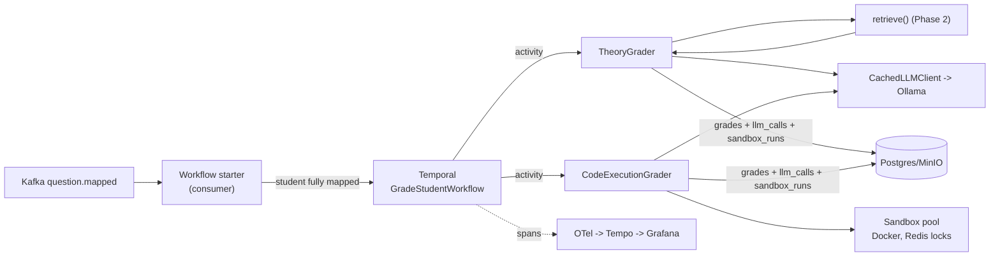

# Phase 3 — Orchestration + First Graders

**Status:** plan for review (no code yet).
**Branch:** `phase-3-orchestration`.
**Prerequisite:** Phase 2 complete (`phase-2-complete` tag); Docker stack +
Ollama running.
**Hardware reality (measured):** 23GB RAM, CPU inference, no gVisor/KVM on
native Windows — both facts shape the open decisions below.

---

## Why this phase exists

Phases 1–2 built a pipeline that understands submissions; nothing yet grades
one. Phase 3 proves the whole orchestration pattern with two graders before
Phase 4 scales to six: a Temporal workflow per student, each grader an
activity with retries and timeouts owned by the engine, results persisted
with the full audit chain (grade → prompt → retrieval → sandbox run), and a
trace visible in Grafana. The plan calls Temporal the "new tech with the
highest payoff" and budgets an onboarding sub-phase inside this one — P3.1 is
exactly that.

## What "done" looks like (Definition of Done, per PROJECT_PLAN §9)

For a synthetic single-student submission with a theory and a code question:

1. `GradeStudentWorkflow` runs in Temporal (visible in the Temporal UI),
   dispatching TheoryGrader and CodeExecutionGrader as activities.
2. Both grades include score, per-criterion breakdown, **reasoning, and
   confidence**, and persist to `grading.grades` correctly.
3. The code grade links a real `grading.sandbox_runs` row (exit codes,
   stdout/stderr refs in MinIO, duration, timeout flag); the theory grade
   links a real `grading.llm_calls` row with request/response payloads in
   MinIO `llm-payloads/` and `retrieval_citations` naming Phase 2 chunks.
4. Student code executes only inside the sandbox: no network, capped memory/
   CPU/wall-clock, non-root, read-only rootfs — and a hostile submission
   (infinite loop, fork attempt, network attempt) is contained and graded 0
   with the containment recorded.
5. Sandbox slots are guarded by Redis locks (`sandbox_lock:*`) — concurrent
   runs never exceed the pool size.
6. **The workflow trace shows up in Grafana** (Tempo): workflow → activities →
   LLM/sandbox spans.
7. Unit tests for prompt building, output parsing, confidence clamping, and
   sandbox verdict mapping; an opt-in e2e test drives the DoD scenario.

## Scope

**In:** Temporal worker + `GradeStudentWorkflow`, TheoryGrader (RAG-grounded,
prompt-cached), CodeExecutionGrader (Docker sandbox + LLM interpretation),
sandbox pool with Redis locks, `grades`/`sandbox_runs`/`llm_calls`
persistence, Kafka→workflow starter, OTel spans through to Tempo, test cases
added to the synthetic rubric.

**Out (Phase 4+):** the other four graders, FeedbackSynthesizer, CrossChecker,
parallel fan-out at class scale, the 250-submission benchmark, review-queue
signaling back into workflows (Phase 5).

## Architecture & flow



- **Workflow:** one `GradeStudentWorkflow` per submission. Phase 3 grades the
  mapped artifacts sequentially (theory, then code); Phase 4 adds the parallel
  fan-out. Retries/timeouts per activity are Temporal policy, not hand-rolled.
- **Starter:** consumes `question.mapped`; when every artifact of a submission
  is mapped (or gated), starts the workflow with `submission_id` — idempotent
  via Temporal workflow-id reuse policy (`grade-<submission_id>`).
- **TheoryGrader activity:** load artifact JSON from MinIO → `retrieve()`
  top-3 chunks → build prompt (system = grading contract; prefix = rubric
  criteria + chunks, keyed for the prompt cache; suffix = student answer as
  data) → LLM → parse strict JSON `{criterion_scores[], confidence,
  reasoning}` → clamp/validate (scores within criterion max, confidence
  [0,1]; one repair retry on malformed JSON, then fail the activity) → persist
  grade + llm_call + payloads.
- **CodeExecutionGrader activity:** acquire sandbox slot (Redis lock, N=2) →
  run student file against rubric test cases inside the sandbox image →
  persist `sandbox_runs` + logs to MinIO → deterministic pass/fail score from
  test weights → LLM writes reasoning/interprets partial failures (does not
  override the deterministic score by more than the rubric's style margin —
  Phase 3 keeps score fully deterministic, LLM contributes reasoning +
  confidence only) → persist grade linking `sandbox_run_id` + `llm_call_id`.
- **Prompt injection defense (per §13):** student content is delimited as
  data, the system prompt forbids instruction-following from it, output is
  schema-validated, scores clamped server-side; injection attempts logged.

## Sandbox design (Windows dev reality)

Resolved decision: **gVisor runsc inside WSL2 Ubuntu**, which runs its own
Docker engine with `runsc` registered as a runtime. The Windows-side pool
invokes it via a configurable command prefix, so the same code runs
`docker --runtime=runsc` natively on Linux. Firecracker remains the prod
target per PROJECT_PLAN §6.

Per run: `python:3.11-slim`-based image (pre-pulled, no registry access at
grade time), `--runtime=runsc`, `--network none`, `--memory 256m --cpus 1
--pids-limit 64`, `--read-only` rootfs + tmpfs `/tmp`, non-root user,
wall-clock timeout (default 10s/test) enforced from outside via container
kill, student dir mounted read-only. Harness inside the container reads
test-case JSON, imports the student module, runs cases, writes results JSON —
the host never `exec`s student code directly.

## Data & storage touched

- `grading.grades`, `grading.llm_calls`, `grading.sandbox_runs` (first real
  writes); MinIO `llm-payloads/`, `sandbox-logs/`.
- Redis `sandbox_lock:<slot>` locks.
- Synthetic rubric gains executable `test_cases` for q2 (inputs + expected
  outputs inline; the generator's correct/buggy CPS variants now produce
  pass/fail spread).
- New deps: `temporalio` (workflow SDK), `docker` (Python SDK for the sandbox
  pool). Both in the root workspace.

## Checkpoint commits

| # | Commit | Contents |
|---|---|---|
| P3.1 | `feat: temporal worker and hello workflow` | temporalio dep, worker bootstrap, trivial workflow + activity round-trip visible in Temporal UI (the onboarding sub-phase) |
| P3.2 | `feat: llm call auditing` | recorder wrapping any LLMClient: `grading.llm_calls` row + request/response payloads to MinIO per call |
| P3.3 | `feat: theory grader` | RAG-grounded prompt build, strict-JSON parse + repair retry, clamping, grade persistence with citations; unit tests |
| P3.4 | `feat: docker sandbox runner with redis-locked pool` | image build, hard limits, harness, `sandbox_runs` + logs persistence, hostile-code containment test |
| P3.5 | `feat: executable test cases and code execution grader` | rubric/test-case upgrade in the generator, deterministic scoring + LLM reasoning; unit tests |
| P3.6 | `feat: grade student workflow` | both graders as activities with retry policy, sequential Phase 3 dispatch, grades persisted end to end |
| P3.7 | `feat: kafka workflow starter` | question.mapped consumer, fully-mapped detection, idempotent workflow starts |
| P3.8 | `test: single-student e2e with grafana trace` | DoD scenario asserted (grades, audit links, containment, trace in Tempo); docs close-out |

## Decisions for this phase

1. **Grader model — RESOLVED: `qwen2.5:3b` for both graders.** Fast enough on
   CPU to keep Phase 4's batch target realistic; the quality gap is exactly
   what confidence gating exists for, and it gets measured honestly in
   Phase 6. Per-grader overrides stay in `LOCAL_MODEL_THEORY` /
   `LOCAL_MODEL_CODE`.
2. **Sandbox tier — RESOLVED: WSL2 + gVisor runsc.** Untrusted code runs under
   gVisor's syscall interception inside the Ubuntu WSL2 distro, which gets its
   own Docker engine (Docker Desktop's managed VM does not accept custom
   runtimes cleanly). The sandbox runner shells out through a configurable
   command prefix (`wsl -d Ubuntu -- docker …` here; plain `docker …` on
   Linux), so the code is host-portable. Docker-with-hard-limits remains the
   documented fallback tier if gVisor-in-WSL2 proves unstable.

## How to verify (once built)

```bash
docker compose up -d
uv run python -m services.orchestrator.worker            # Temporal worker
uv run python -m services.orchestrator.starter           # Kafka -> workflow starter
uv run python scripts/ingest.py ...                      # (already-ingested data works)
AUTOGRADE_RUN_INTEGRATION=1 uv run pytest tests/integration/test_grading_e2e.py -q
# then: Temporal UI (localhost:8233) shows the workflow; Grafana (localhost:3001)
# -> Explore -> Tempo shows the grade trace; psql shows grades/llm_calls/sandbox_runs rows
```
